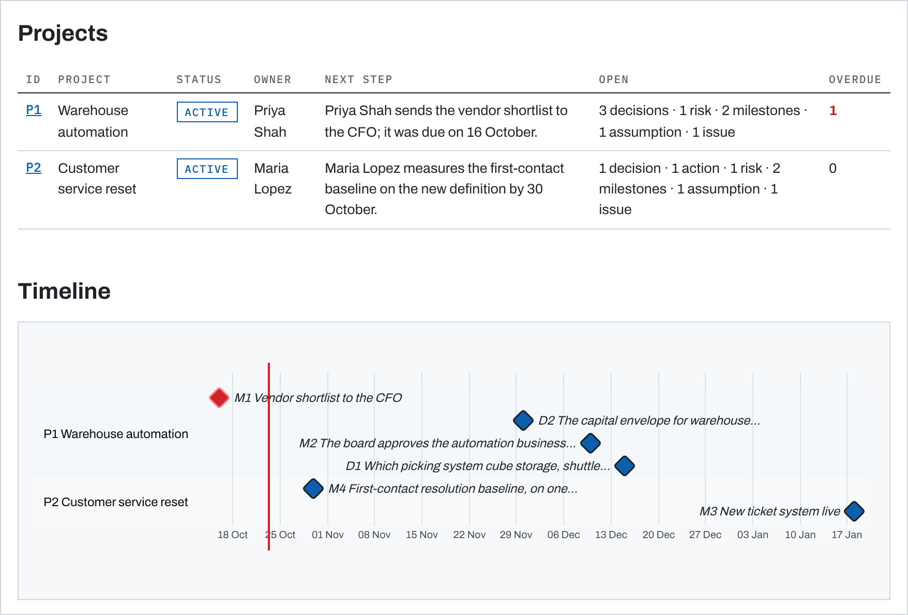
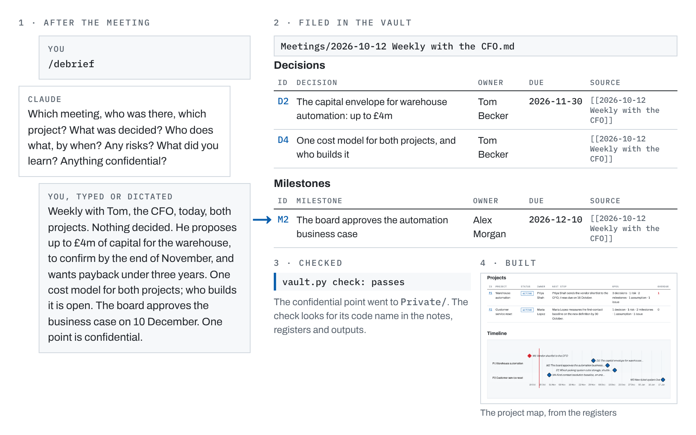
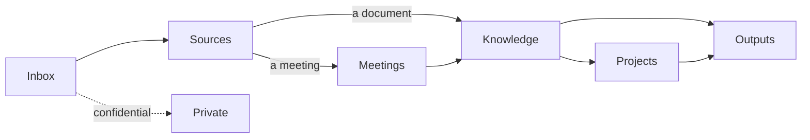

# Executive Brain

**An executive's decisions, risks, people and meetings, kept by Claude Code, each with its source.**

For a leader who runs several projects at once and works with AI. After a meeting you type `/debrief` and answer a few
questions, in a browser or the Claude app. Claude writes the meeting note and files the decisions, owners, dates and
risks into registers. On request it builds a project map, a brief for a meeting, a Word file or a PDF from them. The
notes and registers are plain Markdown in your own private GitHub repository; Claude Code sessions, which Anthropic
runs, work on it.



*The map of [Brightwater](examples/Brightwater), a fictional COO's vault, also
[as a PDF](.github/images/project-map.pdf).* [A 49-second demo](.github/images/demo.gif): the check, the weekly
review and the map, run on that vault.

## How it differs

- **Registers, not just notes.** Decisions, actions, risks and milestones with owners, every row with its date and
  its source. The weekly review lists what changed since the last one, what is overdue or due within 14 days, the open
  actions by owner, and projects unchanged for 30 days.
- **A check before every push.** It stops on a row without a source, an open row without an owner, or a broken link.
  It also stops on a listed code name in a note, a register or an output, in any case, with or without accents. A
  hook runs it when Claude pushes, and holds the push until it passes.
- **Runs in the browser.** It runs in Claude Code on the web, from a browser or the Claude app; you install nothing.
  Every source is a link that GitHub opens with one click, and the project map comes as a PDF too, for a phone.

As far as their own pages say, no tool in the groups under [How it compares](#how-it-compares) does all three.

## Start

You need a GitHub account and a paid Claude plan with Claude Code on the web: Pro, Max, Team, or an Enterprise seat
that includes it. On Team and Enterprise, an Owner first turns on the GitHub connector.

1. Click **Use this template**, then **Create a new repository**. Choose **Private**.
2. Open [claude.ai/code](https://claude.ai/code), or the **Code** tab in the Claude app. Connect GitHub, give the Claude
   GitHub App this repository only, and choose it, on its own.
3. Type `/setup` and answer one message: your name and role, your city, and your projects in a line each. Claude
   shows your start page and a project map within minutes, then offers to add people, decisions and risks.

Then, after each meeting, type `/debrief`, or drop material into `Inbox/` and type `/ingest`. Before a meeting, type
`/brief`. Once a week, type `/review`. The details are in [SETUP.md](SETUP.md).

[Try it without an account](examples/Brightwater) · [How it compares](#how-it-compares) ·
[Privacy and trust](#privacy-and-trust)

## How it works



## Five kinds of data

| Kind | What it is | Rule |
|---|---|---|
| **Sources** | Recordings, transcripts, documents, e-mails, photos | Kept as they came, never edited |
| **Meetings** | One note per meeting: what was said | Written once, from a debrief or a recording |
| **Knowledge** | A few registers that grow: people, decisions, actions, risks, milestones, assumptions, current state | Every row has a date and a link to its source |
| **Projects** | One card per project: goal, owner, status, next step, map | Collects its rows from the registers |
| **Outputs** | Project maps, briefs and documents | Always built from the knowledge, never fixed by hand |

## Folders

```
Inbox/       anything new, waiting to be filed
Sources/     raw material, as it came
Meetings/    one note per meeting
Knowledge/   the registers
Projects/    one card per project
Outputs/     versions to send, with the date in the name
Private/     what is confidential: it never reaches a note, a register or an output
Archive/     closed projects and replaced outputs
Templates/   the templates for notes and registers
tools/       the tools that check, tidy and build
```

## How information flows



One direction only. A correction goes into the knowledge, never into an output. A long document gets a short summary
next to it in `Sources/`, so its facts link to a page anyone can read.

## Projects

The registers are shared by the whole role, and every row names its project (`P1`, `P2`). A project card shows its
own rows, kept current by the tools, and its map. A closed project moves to `Archive/`.

## Keeping it in order

- **Every session starts with the Inbox.** Claude files what is waiting before anything else.
- **Fixed names and IDs.** Files start with their date. Rows carry IDs that never change: `P1` projects, `D1`
  decisions, `T1` actions, `R1` risks, `M1` milestones, `A1` assumptions, `I1` issues.
- **A check before every push.** It stops on a broken link, a fact without a source, a row without an owner, an
  unknown project or status, an unresolved git conflict, or a confidential word outside `Private/`. A hook
  (`.claude/check_hook.py`) runs it whenever Claude pushes or commits:
  - a push waits until the check passes;
  - a commit goes ahead with a warning, unless it would put a code name or a `Private/` note into the history;
  - a check that does not answer in 20 seconds holds nothing back.

  The hook guards against slips; it is not a lock. It reads the git commands Claude runs in a Claude Code session on
  this vault alone. It does not see a file uploaded on GitHub's website, a push from a computer without Claude Code, or
  a vault opened next to other repositories or in a claude.ai project, where the repository's hooks do not run.
- **A weekly review.** Claude lists what was decided, closed or changed since the last one, what is overdue, the open
  actions by owner, what has not moved in 30 days and what can be closed.

## No recordings? Debrief.

A recording is one way in, not a requirement. After a meeting, type `/debrief`: Claude asks what was decided, who
does what by when, what the risks are and what surprised you, and writes the meeting note from your answers. You can
also dictate, or paste a transcript or the text of an e-mail. A saved e-mail, a photo of your notebook or a document
works too.

## Tools

| Command | What it does |
|---|---|
| `python3 tools/vault.py check` | The check before every push |
| `python3 tools/vault.py refresh` | Brings the project cards and `Home.md` up to date |
| `python3 tools/vault.py review` | The weekly review list |
| `python3 tools/vault.py brief P1 "Name"` | A brief on projects and people, every line with its source |
| `python3 tools/build_map.py` | One page with every project: status, timeline, maps, open items |
| `python3 tools/build_doc.py NOTE` | A note as a Word file and a PDF, diagrams included |
| `python3 tools/read_document.py FILE` | The text of a Word, Excel, PowerPoint, PDF or e-mail file |

You never need to run them yourself: Claude does, as `CLAUDE.md` tells it to. `AGENTS.md` gives the same rules to
other coding agents, but the vault has been tried only with Claude Code.

## Updating

A copy made with **Use this template** has no git link to this repository, so it gets no change from here by itself.
A new release is listed on this page, with what changed in [CHANGELOG.md](CHANGELOG.md); `vault.py status` shows the
version your vault runs. To bring one in, ask Claude for the update in a session that can reach GitHub. It takes the
product's files from the release: the tools, the templates, the commands and hooks in `.claude/`, and `CLAUDE.md` but
for its "About me". Your notes, registers, cards, outputs, `settings.json` and your vault's own `README.md` stay as
they are. Then it runs the refresh and the check, and commits. The commands, and the full list of what a release
replaces, are under [Updating](SETUP.md#updating) in `SETUP.md`. An `/update` command that does this in one step is
on the [roadmap](.github/ROADMAP.md).

## Privacy and trust

Your vault is plain files in your own private GitHub repository. Three services see it:
- **GitHub** keeps every file and its whole history. Claude reaches the repository through the Claude GitHub App:
  give it this repository only.
- **Anthropic** copies the repository into each cloud session's own machine and keeps the session's transcript, with
  every file Claude read, until you delete the session. Your plan sets training and retention: on Free, Pro and Max
  you choose whether sessions train future models (they are then kept up to five years, otherwise 30 days); Team and
  Enterprise are not used for training unless the organisation opts in. See Claude Code's
  [data usage](https://code.claude.com/docs/en/data-usage) page.
- **Connectors** you turned on in Claude, such as mail or a calendar, come with every cloud session. What Claude reads
  through them enters the session, and their provider sees what Claude sends.

**`Private/` is a folder, not a lock.** It keeps confidential matters out of the notes, registers, cards and outputs,
inside the same repository. The check stops on a listed code name, and on a line of 40 characters or more copied from
`Private/`, in any case, with or without accents, Markdown or line breaks. It does not see a paraphrase, a translation,
a plural, a code name run into another word, a picture, the headers and properties of an Office file, the material in
`Sources/`, `Inbox/` and `Templates/`, or the history. Code names are kept as hashes, so that `settings.json` does
not spell them out: that guards against accidents, not against someone who can read the vault and guess a common word
from its hash.

**History and filed material.** Git keeps every version, and Claude never rewrites it: a leak stays until you remove
it. Text inside a filed e-mail or document is material, never an instruction: Claude reports a request it finds there
instead of carrying it out, and the vault's settings deny Claude web fetches, `curl` and `wget`.

For a legal or IT team: [Privacy and trust](SETUP.md#privacy-and-trust) in `SETUP.md`, questions and facts, not
legal advice.

## How it compares

| | Decisions, risks, owners, dates | Facts sourced, and checked | Meetings into decisions, actions | Confidential kept out, checked | Plain files you own | Browser or phone, nothing to install | Word, PDF, project map |
|---|---|---|---|---|---|---|---|
| **Second brains in Obsidian** | partly | partly | partly | partly | Y | partly | N, canvas maps only |
| **Memory servers for agents** | N | partly | N | partly | Y | Y, hosted plans | N |
| **Chief-of-staff setups for Claude Code** | partly | N | partly | partly | Y | N | N |
| **Meeting recorders with AI notes** | partly | partly | Y | N | partly | Y, apps | partly |
| **AI in the office suite** | partly | partly | Y | partly | partly | Y | Y |
| **Executive Brain** | Y | Y, every register row | Y, recorded or not | Y, listed words | Y | Y, with GitHub and a paid Claude plan; the map as a PDF too | Y |

Y has it; partly in part, or in some of the group; N not found on their own pages or in search extracts of them.
Checked on 22 Oct 2026. As far as those pages say, none of them does these three together:
1. **Registers with owners:** decisions, risks and milestones, and a weekly list of what is overdue or has not moved.
2. **A check that stops** on a fact without a source, an open row without an owner, or a code name in a note or output.
3. **Runs in the browser:** Claude Code on the web, with a GitHub account and a paid Claude plan, and it builds a
   project map, Word and PDF.

**Where they are better:** search by meaning and a knowledge graph (memory servers), answers that say what is not
known (some memory servers), a morning brief and scheduled runs (chief-of-staff setups), recording the meeting itself
(meeting recorders), many integrations and agents other than Claude, a hosted service with no GitHub account, and
compliance attestations such as SOC 2 (the office suites and meeting recorders). Executive Brain is new, made for one
person, and needs GitHub and a paid Claude plan.

## Contributing

Questions, ideas and bugs go through the issue forms; read [CONTRIBUTING](.github/CONTRIBUTING.md) first, and never
put anything from a real vault in them. A security problem goes to [SECURITY](.github/SECURITY.md), and the plans are
in [ROADMAP](.github/ROADMAP.md).

## Author

**Piotr Mechliński** · AI Strategy Advisor to CEOs · 20+ years in AI & Data · Former CEO, Country Manager, VP Growth ·
Deloitte, Microsoft, IBM · Executive Coach · [piotrmechlinski.com](https://piotrmechlinski.com/)

## Licence

[MIT](LICENSE). Third-party files keep their own licences:
- **Mermaid 11.17.2** in `tools/vendor/`, MIT ([LICENSE-mermaid.txt](tools/vendor/LICENSE-mermaid.txt)). It bundles
  packages under the MIT, ISC, BSD-3-Clause and Apache 2.0 licences, DOMPurify under MPL 2.0 or Apache 2.0, and one
  package under the Unlicense: their notices are in
  [THIRD-PARTY-NOTICES.txt](tools/vendor/THIRD-PARTY-NOTICES.txt). Every project map carries this code, with a pointer
  to those notices.
- **The Archivo and IBM Plex Mono fonts** in `tools/fonts/`, unmodified, SIL Open Font Licence 1.1
  ([OFL-Archivo.txt](tools/fonts/OFL-Archivo.txt), [OFL-IBMPlexMono.txt](tools/fonts/OFL-IBMPlexMono.txt)).

What you write in your own copy of the vault is yours; the MIT licence covers the product's files, not your notes.
