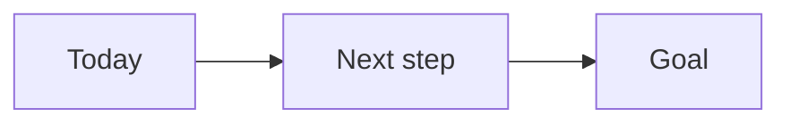

# P0 Name

<!-- status: active, on hold or done. The file name is the ID and the name: "P3 Customer service reset.md". -->

## Goal

One or two sentences: what will be true when this is done.

## Why it matters

What it is worth, and what happens if it does not happen.

## Next step

What happens next, who does it, by when.

## Map

<!-- generated -->
<!-- /generated -->
