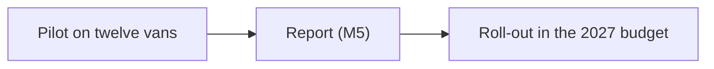

# P3 Route planning pilot

## Goal

A route planning tool tested on twelve vans in the north region, with a decision on rolling it out.

## Why it matters

Fuel is the second cost of the fleet after the drivers.

## Next step

None: the pilot report went to the board in September, and the roll-out is part of the 2027 budget.

## Map

<!-- generated -->
## From the registers

### Milestones

| ID | Milestone | Owner | Due | Status |
|---|---|---|---|---|
| [M5](../../Knowledge/Milestones.md) | Route planning pilot report to the board | Alex Morgan | 2026-09-30 | done |

### Meetings

- [2026-10-05 Setup](../../Meetings/2026-10-05%20Setup.md)
<!-- /generated -->
